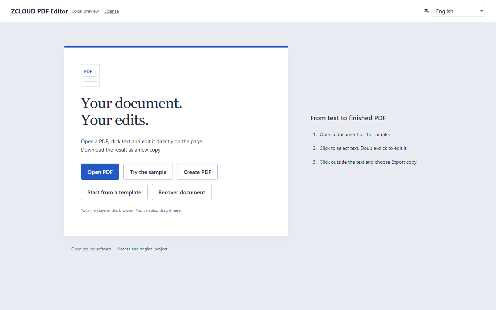
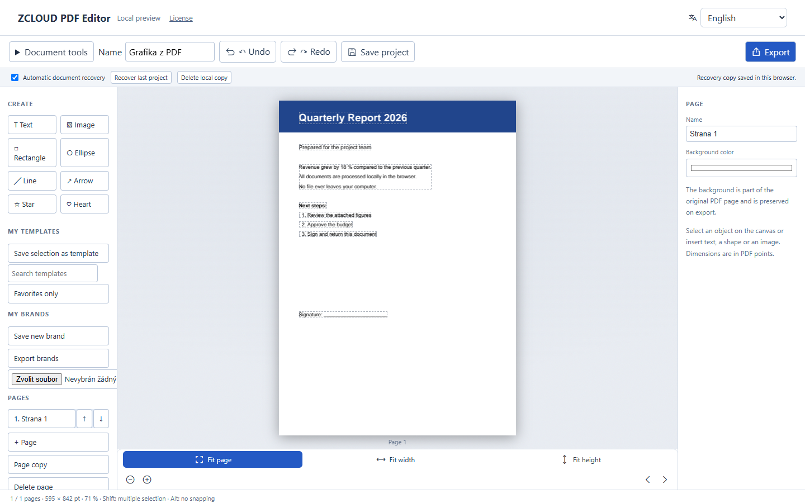

# ZCLOUD PDF Editor

Edit PDFs directly in the browser. Click text on the page and rewrite it, add shapes and images, manage pages, then download a new copy.
Everything runs locally: **your file never leaves your computer**.





## Features

- **Inline text editing** on the original page (fonts, sizes and layout are kept)
- **Create**: text, images, rectangles, ellipses, lines, arrows, stars
- **Pages**: add, copy, reorder, delete, rename, set background
- **Templates and brand kits** you can save and reuse
- **OCR** for scanned pages (English, Czech)
- **Annotations, attachments, accessibility, compare**
- **Office export/import**: DOCX, XLSX, PPTX
- **Auto-recovery**: work is saved in your browser, undo/redo history
- **49 UI languages**

## How to use

1. Open a PDF (button or drag & drop), or try the sample.
2. Click text to select it, double-click to edit.
3. Use the left panel to add objects or manage pages; the right panel shows properties.
4. Click **Export** to download the edited copy.

## Run locally

Tested with Node.js 24.

```bash
npm ci
npm run dev:editor
```

Open http://localhost:5173/editor.html.

Production build (output in `dist-editor/`, static files, host anywhere):

```bash
npm run build:editor
npm run preview:editor
```

The server must send `Cross-Origin-Opener-Policy: same-origin` and `Cross-Origin-Embedder-Policy: require-corp` (the editor runs WebAssembly engines that need them). The Vite config does this for dev and preview.

## Tests

```bash
npm run qa:types
npm run qa:unit
```

## License and origin

Fork of [BentoPDF](https://github.com/alam00000/bentopdf) by alam00000, licensed under **AGPL-3.0** (see [LICENSE](LICENSE)).
The original BentoPDF toolkit (merge, split, convert, ...) is still in this repo; its README is in [docs/UPSTREAM-README.md](docs/UPSTREAM-README.md).
Third-party components, fonts and OCR models are listed in [docs/legal](docs/legal).
