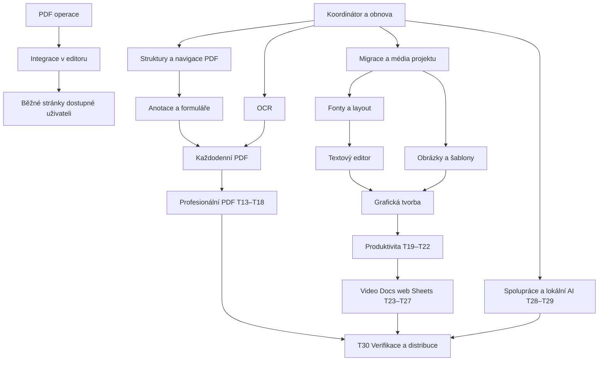

# ZCLOUD PDF Editor — Complete Editor Implementation Plan

> **For agentic workers:** REQUIRED SUB-SKILL: Use superpowers:subagent-driven-development (recommended) or superpowers:executing-plans to implement this plan task-by-task. Steps use checkbox (`- [ ]`) syntax for tracking.

**Goal:** Dodat v jedné aplikaci běžné i profesionální PDF pracovní postupy, grafickou tvorbu a navazující obsahové editory z researchu; vynechat pouze ekosystém komerčních služeb.

**Architecture:** Zachovat TypeScript/Vite aplikaci, nativní PDFium editcore a grafickou vrstvu nad jedním projektem. Rozšíření procházejí společným koordinátorem dokumentu, transakcemi, kontrolou zachování struktur a exportním preflightem. Video, Docs, web a tabulky mají vlastní typovaný obsah ve společném projektu, nikoli druhou aplikaci.

**Tech Stack:** Existující TypeScript, Vite, PDFium/WASM, PDF.js, pdf-lib, fontkit, IndexedDB, SVG, JSZip; upstream kandidáti Tesseract, qpdf a další až po odděleném ověření licence a lokálních aktiv. Nový framework ani server není podmínkou první vlny.

**Spec:** [PDF gap analysis](../../research/2026-10-26-pdf-gap-analysis.md), [Canva gap analysis](../../research/2026-10-26-canva-gap-analysis.md), [společný roadmap](../../research/2026-10-26-unified-product-roadmap.md). Tento plán rozšiřuje jejich doporučení podle pokynu uživatele z 26. 10. 2026: plánovat všechny oblasti kromě „Ekosystém služeb“ a zahájit implementaci. Pokyn již autorizuje realizaci; nečekat na další schválení plánu.

## Global Constraints

- All shipped code, engines, models and fonts must be open source, with corresponding sources and notices. No paid services.
- Documents stay in the browser. Never log document contents, filenames, passwords or keys.
- Never equate drawing a rectangle with redaction. Never silently rasterize exports.
- Práce na `feat/online-pdf-editor`; žádný push, veřejný deployment ani publikace bez pokynu uživatele. Otevřené zdrojové/distribuční brány P00/P01 se tímto plánem neuzavírají.
- Současné limity: nejvýše 200 stránek, 10 000 grafických objektů, historie nejvýše 80 stavů, projektový JSON do 100 × 1024 × 1024 znaků; nejsou to tvrzení o výkonu. Nové PDF operace: 50 MiB na vstup a 100 MiB součet vstupů. Limity nezvyšovat bez měření.
- Testy nepoužívají soukromé dokumenty. Nové texty UI patří do stávající lokalizace 49 jazyků; názvy souborů a autorský obsah se nepřekládají při změně jazyka.
- Přítomnost upstream modulu není dodaná funkce. Stav `ověřeno` vyžaduje dostupnost ve společném editoru, uložení výsledku, nezávislé přečtení výstupu a browserový scénář.
- Exkluze: globální stock katalog, neomezené hostované generování AI, tisková výroba/doprava, vlastní globální cloudová služba. Lokální AI, příprava pro tisk, export pro sítě a protokol spolupráce zůstávají v plánu.
- Vzdálená spolupráce je plánovaná volitelná schopnost, defaultně vypnutá. Implementace klientského protokolu není oprávnění automaticky nahrávat dokumenty; připojení konkrétního serveru vyžaduje výslovný výběr uživatele a změnu lokálního kontraktu.

## Review Focus

1. PDF s formuláři, záložkami, tagy, podpisy, šifrováním nebo přílohami nesmí po obyčejném otočení/rozdělení tiše ztratit strukturu — T01, T04, T08, T14.
2. Současné nativní a grafické úpravy nesmí zmizet při importu, zrušení, chybě workeru, přepnutí nástrojů nebo obnově — T02–T03, T05.
3. Otočené/CropBox/UserUnit stránky a kombinace různých rozměrů musí správně mapovat text, grafiku i anotace — T01–T02, T06, T09.
4. Arabské/indické/CJK písmo, náhradní font a přetečení textu nesmí vytvořit prázdné glyfy nebo jiný export než náhled — T10–T11, T20, T24.
5. Chyba či zrušení těžkého výpočtu, chybné médium a vyčerpání úložiště ponechají poslední validní dokument; redakce naopak odstraní staré citlivé kopie — T03, T07, T13, T23, T28.

## Výchozí stav a přesnost kontraktů

Existující API: `StudioProject` verze 1 v `src/editor/studio/types.ts`; `prepareNativeDocument(project)` a `mergeNativeSnapshot(project, bytes)` v `document-bridge.ts`; `StudioController.getProject/setProject/getActivePageId`; `readRecovery/writeRecovery/clearRecovery` v `recovery.ts`; `setupStudio(getApp, launchPdf)` v `host.ts`. `ProjectHistory` drží plné kopie grafického projektu. Nativní historie a grafická historie nejsou jednotné. Samotný `mergeNativeSnapshot` nepodporuje libovolné změny rozměrů/pořadí; nepoužívat jej jako obecný strukturální adaptér.

Všechna další API níže jsou **navržené kontrakty**, dokud nejsou implementována a otestována. T01 kontrakt je dohodnut s aktuálním implementerem. Cesty označené „nové“ nemusí zatím existovat. Když navazující implementace kontrakt změní, musí zároveň aktualizovat spotřebitele, testy i tento plán.

## Milníky a závislosti

### UX priorita po zpětné vazbě uživatele

Závazný doplněk: [Ovládání textu a kontextová lišta](../../research/2026-10-26-editor-interaction-ux.md). Obsahuje doložený research Canvy/Figmy/Acrobatu, audit aktuálního kódu a akceptaci UX01–UX04.

- [ ] UX01: skutečná inline editace grafického textu dvojklikem nebo Enter; oddělení výběru objektu od výběru znaků, IME a undo.
- [ ] UX02: společná horní kontextová lišta font/velikost/B/I/U/barva/align/v-align/mezery; zachování výběru při kliknutí do lišty a adaptér nativních PDF vlastností.
- [ ] UX03: podporovaný datový model a jednotný layout/export pro stylové úseky, B+I a svislé zarovnání; navazuje na T10/T11.
- [ ] UX04: úkolová validace použitelnosti a browserové regresní scénáře včetně klávesnice, RTL, zoomu a dotyku.

UX01/UX02 mají přednost před dalšími grafickými efekty a rozšiřováním obsahových editorů. T03 a T10/T11 dodávají potřebné transakce a sazbu. Běžné PDF úkoly zůstávají souběžnou prioritou. Nový panel nesmí přidat další odlišné chování téhož textu.

**Ověřený řez UX (26. 10.):** inline dvojklik/Enter, rozsahy B/I/U/velikost/barva, horní lišta a svislé zarovnání jsou implementované. Browser potvrdil skutečný dvojklik, zachování výběru při formátování a obnovu stylů; 1285 testů/80 souborů prošlo, build i závěrečný review prošly. UX03 nadále neznamená kompletní shaping všech písem; UX04 nemá dokončenou celou RTL/dotykovou matici. Checkboxes představují celou akceptaci, ne pouze tento řez.

První vlna nečeká na celý koordinátor: T01–T02 používají atomický preflight a checkpoint s jasným chováním historie. Pokročilé mutující nástroje se připojí až přes T03. Milníky jsou závislosti, nikoli nepodložený termín dodání.

## Paralelní vlastnictví

| Proud | Vlastnictví | První dodávka | Závislost |
| --- | --- | --- | --- |
| PDF worker | `src/editor/pdf/page-operations.ts`, `page-operations.test.ts` | T01 čisté funkce, guardy a roundtrip testy | Žádná změna hostu |
| Integrátor | `studio/host.ts`, nový panel, koordinátor a propojení modelů | T02 UI nad aktuálními daty, následně T03 | Kontrakt T01 |
| Grafik/text worker | Nové izolované typography/image moduly a jejich testy | T10 layout/preflight, T12 obrazové parametry | Změny `types.ts` a exportu koordinovat |
| Nezávislý reviewer | Čtení diffů a výstupů, validační fixtures | Zachování dat a skutečná uživatelská cesta | Po implementaci každého milníku |

Na společném souboru pracuje vždy jeden vlastník. Package/config, `types.ts`, `project-io.ts`, `host.ts`, i18n katalogy a nativní `app.js` koordinuje integrátor. Plánovací agent mění jen tento dokument. Nepřepisovat cizí změny, nevytvářet další aplikaci nebo druhou sadu tlačítek pro tentýž dokument.

## První vlna — již zahájená implementace

### Ověřený dílčí výsledek 26. 10. 2026

- [x] Engine rotate/extract/merge/crop a ochrany vstupů: 25 testů.
- [x] Správa stránek dostupná z nativní i společné lišty: rozsah, duplicate/delete/reverse/rotate 90° a export výběru; atomické odmítnutí a undo checkpointy.
- [x] Nových pět UI zpráv přeloženo ve všech 49 katalozích (411 klíčů).
- [x] Nezávislé review a opravy tří nálezů: ochrana při strukturální normalizaci, zachování čistě grafických stránek, metadata při změnách a extrakci.
- [x] Celá sada před posledními review opravami: 1 241 testů / 76 souborů. Po opravách 84 cílených testů / 4 soubory a TypeScript + build prošly. Nejde o tvrzení, že celá sada byla po poslední opravě opakována.
- [x] Browser ukázka: 2 stránky → duplikace na 3 → Zpět na 2 → otočení na viditelných 842 × 595 bodů → stažení výběru. Nezávislé načtení staženého PDF potvrdilo 1 stránku, MediaBox 595 × 842 a rotaci 90°.
- [ ] Nové UI merge/crop/split, úplný T02, OCR, formuláře, anotace a následující úkoly zůstávají k implementaci. Níže uvedené celé úkoly nejsou automaticky dokončené tímto dílčím výsledkem.

Evidence: `tests-page-manager-final.log`, `tests-page-reviewed.log`, `build-page-manager.log`; screenshot `.superpowers/sdd/2026-10-25-online-pdf-editor/page-manager-preview.jpg`.

### T01 — Čisté operace nad PDF

**Soubory:** nové `src/editor/pdf/page-operations.ts`, `src/editor/pdf/page-operations.test.ts`. **Vlastník:** `pdf_operations`. **Stav:** worker dodal engine a hlásí 25 úspěšných testů; integrační/browser ověření eviduje integrátor samostatně.

**Rozhraní:** `rotatePdfPages(bytes: Uint8Array, indices: readonly number[], angle: number): Promise<Uint8Array>`; `extractPdfPages(bytes: Uint8Array, indices: readonly number[]): Promise<Uint8Array>`; `mergePdfDocuments(inputs: readonly Uint8Array[]): Promise<Uint8Array>`; `cropPdfPages(bytes: Uint8Array, indices: readonly number[], box: {x:number;y:number;width:number;height:number}): Promise<Uint8Array>`.

Indexy jsou od nuly, v požadovaném pořadí, bez duplicit. Otočení je relativní násobek 90°. CropBox je v neotočených PDF souřadnicích uvnitř MediaBox; jde o změnu viditelné oblasti, nikoli odstranění obsahu. `PageOperationError.code`: `invalid-input`, `invalid-selection`, `invalid-angle`, `invalid-crop`, `unsupported-structure`, `encrypted`, `signed`, `limit-exceeded`.

Dodané doplňkové API: `assertPageOperationSupported(bytes:Uint8Array,operation:PageOperation):Promise<void>`, `PageOperation = 'rotate'|'extract'|'merge'|'crop'`, typy `PdfCropBox` a `PageOperationErrorCode`. Host musí kontrolovat původní bytes před bridge reserializací; extrakce není sanitizace a merge přebírá popsanou politiku metadat prvního dokumentu.

- [ ] Přidat testy `rotateSelectedPagesPreservesOtherPages`, `extractRespectsOrder`, `mergePreservesPageSizes`, `cropRejectsOutsideMediaBox`, `selectionRejectsDuplicatesAndOutOfRange`, `rejectsSignedEncryptedAndOversizedInputs`.
- [ ] Spustit `npx vitest run src/editor/pdf/page-operations.test.ts --maxWorkers=2`; před implementací očekávat chybějící API nebo selhání relevantního tvrzení.
- [ ] Implementovat přes existující pdf-lib bez rasterizace a mutace vstupního pole. Rotate/crop přepisují stejný dokument a zachovávají katalog; podepsané a šifrované vstupy se odmítnou. Merge/extract odmítnou dosud nepodporované struktury včetně formulářů, záložek, name trees/příloh, tagů, anotací/odkazů a optional content.
- [ ] Otestovat katalogové struktury samostatně: rotate/crop zachovají ověřenou strukturu; merge/extract ji explicitně odmítnou. Výstup načíst nezávisle přes PDF.js a zkontrolovat text, pořadí, rozměry a rotaci.
- [ ] Opakovat uvedený příkaz, očekávat všechny testy PASS; integrátor převezme API až po výsledku.

### T02 — Panel Stránky ve společném editoru

**Soubory:** dodané `src/editor/studio/page-manager.ts`, `page-actions.ts`, `page-actions.test.ts`; plánovaný `src/editor/studio/page-manager.test.ts`; změny `src/editor/studio/host.ts`, `host.css`, `toolbar-icons.ts`, `i18n/catalog.ts`, `i18n/translations/*.json`; rozšířit `src/tests/studio-host.test.ts`. **Vlastník:** integrátor.

**Průběžný stav od integrátora:** společný/nativní správce stránek nyní zahrnuje rozsahy, duplikaci, mazání, obrácení, otočení ±90/180, extrakci, ořez v pt/mm, připojení více lokálních PDF a split do ZIP. Nové akce jsou propojené s hostem a testované. Browser ověřil ořez o 25,4 mm (72 pt), zachování grafické vrstvy a nový panel; kompletní merge/split browser roundtrip a celá akceptační matice zůstávají k ověření.

**Dodané rozhraní:** `mountPageManager(body,project,activeIndex,run:(request:PageManagerRequest)=>Promise<void>,close):()=>void`. Request je diskriminovaný union delete/duplicate/reverse/extract/split se selection, rotate navíc angle, crop navíc margins a unit, merge s files. `applyPageAction(project,action)` přijímá delete/duplicate/reverse/rotate/crop a nulové indexy; `mergeProjectPdfs(project,inputs)` vrací nový projekt; `splitProjectPages(project,indices)` vrací ZIP; `exportSelectedPages(project,indices)` vrací PDF. Parser `parsePageSelection(input,count)` převádí UI rozsahy z 1-based na 0-based.

- [ ] Testovat rozsahy `1,3-5`, prázdný výběr, `0`, `5-2`, dvojité indexy a neplatná čísla. Testovat disabled stav při čekání, Escape/zrušení a opakovaný klik.
- [ ] Přidat společné tlačítko Stránky s ikonou, výběr aktuální/všech/rozsahu, otočení ±90/180, crop s jednotkami, sloučení lokálních PDF a extrakci/rozdělení do souborů. Současné duplicate/move/delete zpřístupnit z téhož panelu.
- [ ] Host před operací synchronizuje nativní snapshot do projektu. Extrakce je odvozený export a otevřený projekt nemění. Mutace se připraví mimo živý stav; teprve validní výsledek se vloží jako jediný checkpoint. Zrušení/odmítnutí ponechá původní stav.
- [ ] Grafické objekty zachovat jako objekty, ne připalovat do podkladu. Rotate/crop vyžadují explicitní transformaci jejich souřadnic; pokud první řez některou kombinaci neumí, odmítne ji ještě před změnou s konkrétním důvodem. Žádné skryté odstranění vrstvy.
- [ ] Ověřit synthetic PDF: nativní česká změna + grafický objekt → panel → otočení/extrakce → uložení → znovuotevření. Smíšené velikosti, CropBox, UserUnit, selhání druhého merge vstupu a zrušení nesmějí ztratit práci. Spustit testy panelu/hostu a `npm run build:editor`.

## Základ pro všechny další nástroje

### T03 — Jednotné transakce, historie a obnova

**Soubory:** nové `src/editor/document/coordinator.ts`, `coordinator.test.ts`, `checkpoint-store.ts`, `checkpoint-store.test.ts`; změny `studio/host.ts`, `document-bridge.ts`, `recovery.ts`, `model.ts`; úzký revision hook v `src/js/editcore/app.js`.

**Navržený kontrakt:** `DocumentCheckpoint { revision: number; project: StudioProject; nativeRevision: number }`; `DocumentCoordinator.capture(): Promise<DocumentCheckpoint>`; `transact(label: string, prepare: (before: DocumentCheckpoint, signal: AbortSignal) => Promise<StudioProject>, signal?: AbortSignal): Promise<void>`; `undo(): Promise<void>`; `redo(): Promise<void>`. Koordinátor drží pořadí příkazů a před commit ověří revizi; stale výsledek nesmí přepsat novější editaci.

- [ ] Testy `nativeAndGraphicsSurviveReload`, `staleWorkerCannotCommit`, `cancelRetainsOldCheckpoint`, `quotaFailureKeepsLastRecovery`, `undoAcrossNativeAndPageOperation` nejdříve selžou na stávající hranici historie.
- [ ] Serializovat transakce a zaznamenat nativní snapshot při debounce změny, nikoli pouze při Save/přepnutí. Hlášení „uloženo“ až po dokončené IndexedDB transakci. Čekající snapshot neblokuje psaní; při změně revize se výsledek zahodí/replánuje.
- [ ] Persistovat dva validní checkpointy a ukazatel na nejnovější atomicky; poškozený poslední záznam nabídne starší. Vypnutí obnovy a smazání místních kopií ruší čekající zápisy.
- [ ] Zajistit skutečné společné undo/redo snapshotů se zachováním výběru a stránky. Přechodně hlásit hranici resetu, dokud příslušný native adapter neumí obnovit snapshot; neschovávat reset za společné tlačítko.
- [ ] Spustit `npx vitest run src/editor/document --maxWorkers=2` a crash/reopen browser scénář. T03 dokončit teprve po prokázání obou vrstev.

### T04 — Zachování struktur PDF a navigace

**Soubory:** nové `src/editor/pdf/structure-profile.ts`, `page-reference-map.ts`, `navigation.ts`, souběžné `.test.ts`; změny `page-operations.ts`, `studio/exports.ts`.

**API návrhu:** `inspectPdfStructures(bytes: Uint8Array): Promise<PdfStructureProfile>`; `remapPageReferences(bytes: Uint8Array, mapping: readonly {oldIndex:number;newIndices:readonly number[]}[]): Promise<Uint8Array>`; `editNavigation(bytes: Uint8Array, change: NavigationChange): Promise<Uint8Array>`. Profil explicitně uvádí forms, annotations, outlines, destinations, attachments, tags, encryption, signatures, optional content. Neznámá struktura není `false`.

- [ ] Fixture s odkazem na přesunutou/smazanou/duplikovanou stránku, bookmark stromem, name tree, widgetem a tagy musí zachovat či deterministicky odstranit pouze odkazy na odstraněný cíl.
- [ ] Implementovat stable page IDs a obousměrnou mapu; odemykat strukturální operace po jedné ověřené rodině, ne odstranit guard plošně.
- [ ] Přidat panel záložek a odkazů, vlastnosti dokumentu/XMP a přílohy s explicitním import/export/remove; externí odkazy neotvírat automaticky, přílohy nespouštět.
- [ ] Testy `page-reference-map.test.ts`, `navigation.test.ts` včetně cyklů a poškozených referencí; PDF.js render + object inspection. Nepodporovaný profil zůstává odmítnutý.

### T05 — Projekt v2, migrace a sdílená média

**Soubory:** nové `src/editor/document/project-v2.ts`, `migrations.ts`, `asset-store.ts` a jejich testy; změny `studio/types.ts`, `project-io.ts`, `model.ts`, `recovery.ts`.

**API návrhu:** `migrateProject(value: unknown): ProjectV2`; `ProjectV2 { version:2; name:string; assets:Record<string, EmbeddedAsset>; sections:DocumentSection[] }`; `DocumentSection` diskriminovaný union `design|pdf|slides|flow|sheet|board|web|timeline`, každý má stabilní ID a vlastní validátor. `EmbeddedAsset` obsahuje MIME, hash a embedded bytes/reference do lokálního store; žádné síťové URL při otevření projektu.

- [ ] Testovat všechny v1 fixtures, roundtrip bez změny textu a geometrie, neznámou povinnou variantu, duplicitní ID a poškozený hash.
- [ ] Migrace je pure a nesmaže původní lokální checkpoint; nová verze se ukládá až po úspěšné validaci. Velká média jsou sdílená podle hash, historie ukládá změny/reference místo 80 kopií base64.
- [ ] Přidat migraci a backward read, exportní balíček i obnovu; odmítnout chybějící asset místo prázdného obrázku. Pro v1 zachovat kompatibilní import.
- [ ] `npx vitest run src/editor/document/migrations.test.ts src/editor/document/asset-store.test.ts --maxWorkers=2`; měřit velikost 100 opakovaných instancí stejného obrázku.

## Běžná práce s PDF — další dodávky

### T06 — Standardní anotace a formuláře

**Soubory:** nové `src/editor/pdf/annotations.ts`, `annotation-panel.ts`, `forms.ts`, `form-panel.ts` a testy; adaptéry k existujícím `src/js/logic/edit-pdf-page.ts`, `form-creator.ts`, `form-filler-page.ts` bez bootstrapu samostatných upstream stránek.

**API návrhu:** `readAnnotations(bytes): Promise<PdfAnnotation[]>`; `applyAnnotationChanges(bytes, changes: readonly AnnotationChange[]): Promise<Uint8Array>`; `readFormFields(bytes): Promise<FormField[]>`; `applyFormChanges(bytes, changes: readonly FormChange[]): Promise<Uint8Array>`. Typy definovat ve `src/editor/pdf/annotation-types.ts` a `form-types.ts`; ID odpovídá stabilní PDF referenci, ne pořadí z UI.

- [ ] A: Test highlight/underline/strikeout/note/ink/stamp, text selection na otočené stránce, thread reply/resolve, import/export XFDF. Implementovat data a appearance streams; běžný tvar ve studiu se za anotaci nepovažuje.
- [ ] B: Fill/save pro text, checkbox, radio, choice; test stejnojmenných polí, Unicode, read-only, required a prázdných hodnot. XFA a PDF JavaScript detekovat a nevykonávat.
- [ ] C: Tvorba/přesun/mazání polí, validace jmen, tab order, export/import hodnot JSON/FDF/XFDF; spojování dokumentů nesmí nechtěně svázat stejnojmenná pole.
- [ ] Každý řez má samostatný testovací běh `.test.ts`, UI na jednom dokumentu a otevření v další čtečce. T06 je hotové až po A+B+C, dílčí stav uvést přesně.

### T07 — OCR a práce se skenem

**Soubory:** nové `src/editor/pdf/ocr-service.ts`, `ocr.worker.ts`, `ocr-panel.ts`, `ocr-service.test.ts`; využít `src/js/utils/ocr.ts`, `hocr-transform.ts`; assets v curated build allowlistu.

**API návrhu:** `recognizePages(bytes: Uint8Array, request: {indices:readonly number[];languages:readonly string[];mode:'searchable'|'editable'}, signal:AbortSignal, progress:(done:number,total:number)=>void): Promise<OcrResult>`; `OcrResult` drží rozpoznané bloky/confidence a nový PDF snapshot. `editable` se zpřístupní až po řezu C.

- [ ] A: Připnout engine/modely CZ+EN, zdroje/notices a lokální worker; test bez internetu. OCR se spouští po jedné stránce, respektuje rozsah a zrušení; původní obraz zůstává vizuálně shodný.
- [ ] B: Deskew, orientace, kontrast/odstranění šumu s náhledem a resetem; CZ/EN čistý a hlučný korpus, zaznamenat CER/WER, textovou pozici a špičku paměti na popsaném zařízení. Chybný výsledek má ruční opravu.
- [ ] C: Rekonstrukce editovatelných bloků s explicitní confidence, sloupci, tabulkami a nabídkou porovnání se skenem. Neprohlašovat plošnou bezztrátovost; původní scan zachovat jako vratný zdroj mimo redakční režim.
- [ ] `npx vitest run src/editor/pdf/ocr-service.test.ts --maxWorkers=2` + browser worker/cancel/offline fixture. OCR accuracy měřit jako benchmark, nikoli nahradit mockem.

### T08 — Číslování, vodoznaky, optimalizace a dávkové PDF úlohy

**Soubory:** nové `src/editor/pdf/page-furniture.ts`, `optimize.ts`, `batch.ts` a `.test.ts`; panely ve `src/editor/pdf/utility-panel.ts`.

**API návrhu:** `applyPageFurniture(bytes, spec: FurnitureSpec): Promise<Uint8Array>`; `optimizePdf(bytes, options: OptimizationOptions, signal: AbortSignal): Promise<OptimizationResult>`; `runPdfBatch(items: readonly BatchItem[], pipeline: readonly PdfOperationSpec[], signal: AbortSignal): AsyncGenerator<BatchOutcome>`.

- [ ] Záhlaví/zápatí, čísla stran, Bates prefix/start/padding/range, textový/obrazový vodoznak musí přežít opakované otevření; úprava spravované položky ji nenasadí podruhé. Test rotace a rozdílných velikostí.
- [ ] Komprese nabídne očekávaný dopad a porovnání; zachovat text a vektory. Lossless cleanup a volitelná lossy recomprese obrázků jsou oddělené volby; repair nesmí tvářit nečitelný vstup jako opravený bez ověření.
- [ ] Detekce prázdných/duplicitních stran nabídne kandidáty k výběru, nemaže automaticky. Dávka zpracovává omezený počet vstupů, izoluje selhání, má zrušení a ZIP výstup; názvy nesmějí vytvářet path traversal.
- [ ] Testy všech tří modulů plus kombinovaný anotovaný/form PDF zachová strukturu; změřit velikost a render před/po.

### T09 — Porovnání dokumentů a měřicí nástroje

**Soubory:** nové `src/editor/pdf/compare.ts`, `measurements.ts`, panely a `.test.ts`.

**API návrhu:** `comparePdf(a:Uint8Array,b:Uint8Array,signal:AbortSignal):Promise<ComparisonReport>`; `measureGeometry(points: readonly {x:number;y:number}[], calibration:{pointsPerUnit:number;unit:string}):Measurement`.

- [ ] Zarovnání vložených/smazaných stránek, textové a vizuální změny, tolerance anti-aliasingu, procházení změn a export reportu. Test vložené první stránky nesmí označit všechny další za změněné.
- [ ] Délka/obvod/plocha s ruční kalibrací, jednotkami a uloženou anotací; test CropBox, UserUnit a rotace proti známé geometrii. Bez kalibrace neprezentovat odhad jako skutečný rozměr.
- [ ] Ověřit cancel a velký porovnávaný dokument bez uložení privátních dat do logu.

## Grafická tvorba

### T10 — Fonty, komplexní písma a sdílený textový layout

**Soubory:** nové `src/editor/typography/fonts.ts`, `shape.ts`, `layout.ts`, `preflight.ts` a testy; změny `studio/canvas.ts`, `exports.ts`; auditované font assets.

**API návrhu:** `layoutText(input: TextLayoutInput, fonts: FontRegistry): Promise<TextLayout>`; vstup obsahuje box, runs, směr, jazyk, řádkování a tracking; výstup pozice glyphů, Unicode vazby, řádky a overflow. `checkGlyphCoverage(text:string,fontId:string):Promise<MissingGlyph[]>` nikdy nezaměňuje dostupný browser fallback za vložený PDF font.

- [ ] Fixture CZ diakritika, Arabština+čísla, Devanagari, CJK, ligatury, emoji a kombinující znaky; očekávat detekci nepodporovaného skriptu před exportem.
- [ ] Zvolit lokální shaping backend po licenčním a kvalitativním spike; stejný layout musí použít SVG náhled i PDF/PPTX export. Chybějící glyph nabídne auditovaný font nebo zastaví daný export, ne tichý čtvereček.
- [ ] Ověřit zalamování, bidi, selektovatelný Unicode a pixelovou shodu renderů. Font subset nesmí zničit ToUnicode mapu. `npx vitest run src/editor/typography --maxWorkers=2` plus skutečné fontové fixtures.

### T11 — Bohatý text a rozvržení návrhu

**Soubory:** nové `src/editor/studio/text-editor.ts`, `layout-rules.ts`, testy; změny `types.ts`/v2 schema, `canvas.ts`, `exports.ts`, `model.ts`.

**API návrhu:** `TextRun { text:string;style:TextStyle }`; `TextStyle` má font ID, velikost, barvu, řez, underline; odstavec align/list/spacing/direction. `resizeDesign(project:ProjectV2,sectionId:string,size:{width:number;height:number},rules:readonly LayoutRule[]):ProjectV2`.

- [ ] Rich-text úseky, zalamování, odrážky/číslování, line/paragraph spacing, tracking; test undo celé editace, caret při locale switch a overflow badge. Původní v1 text migruje na jediný run.
- [ ] Vlastní vodítka, distribuce rozestupů, přikotvení k hranám, znovupoužitelné bloky a změny formátu s náhledem. Existující snapping zachovat; resize nesmí měnit zdrojové PDF bez odpovídajícího explicitního postupu.
- [ ] Stín, outline, gradient a text na křivce přidávat po jednom s exportním profilem editable/vector/raster/unsupported. Test PDF/SVG/PPTX výstupů, raster fallback jen po zobrazení dopadu.

### T12 — Obrázky, vlastní šablony a značky

**Soubory:** nové `src/editor/studio/image-effects.ts`, `image-masks.ts`, `asset-library.ts`, testy; změny `templates.ts`, `brand-kit.ts`, `canvas.ts`, `exports.ts`.

**API návrhu:** `ImageEdits {crop;mask;brightness;contrast;saturation;blur}`; `renderEditedImage(asset:EmbeddedAsset,edits:ImageEdits,signal:AbortSignal):Promise<Blob>`; `insertTemplate(project:ProjectV2,template:Template,at:number):ProjectV2`; `applyBrand(project:ProjectV2,brand:BrandKit,selection:readonly string[]):ProjectV2`.

- [ ] Nedestruktivní crop drag/fit/fill, kruhové/zaoblené masky, replace se zachováním boxu, reset a filtry. Test alpha okraje, EXIF orientace, extrémní rozměry a shoda exportu.
- [ ] Uložit stránku/výběr jako osobní šablonu, vkládat do stávajícího projektu místo jeho nahrazení; tagy, hledání, oblíbené a náhledy. Média z lokálního uploadu s evidencí původu/licence.
- [ ] Více značek, textové styly, role barev, import/export a vratné aplikování na výběr/projekt; test že se nezmění nepřiřazené uživatelské barvy ani text.
- [ ] Lokální segmentace pozadí a ruční maskovací štětec jsou samostatný řez: model code/weights/source gate, download velikost, benchmark zařízení a cancel; uchovat původní obrázek.

## Profesionální PDF

### T13 — Skutečná redakce a sanitizace

**Soubory:** nové `src/editor/pdf/redaction.ts`, `redaction.test.ts`, `sanitization-policy.ts`; adaptovat `src/js/utils/redact-document-data.ts`; propojit T03 store.

**API návrhu:** `applyRedactions(checkpoint:DocumentCheckpoint,marks:readonly RedactionMark[],policy:SanitizationPolicy,signal:AbortSignal):Promise<SanitizedCheckpoint>`. Výsledek smí commitnout jen speciální nevratná transakce, která purguje předchozí recovery/history/source/asset kopie patřící dokumentu.

- [ ] Test planted secrets v textu, částečně překrytém obrázku, vektorech, transparentní vrstvě, komentářích, přílohách, metadata a předchozí revizi; hledat po dekompresi objektů i extrakcí a renderem.
- [ ] Preview značek a explicitní Apply; odstranit obsah, ne překrýt. Nepodporované objekty odmítnout. Ořez stránky nesmí být nabízen jako redakce.
- [ ] Purge musí být dokončen a ověřen před hlášením úspěchu; při selhání lokálního úložiště oznámit neúplné odstranění a nevydat důvěryhodné potvrzení. Bezpečnostní review před zpřístupněním.

### T14 — Šifrování a certifikátové podpisy

**Soubory:** nové `src/editor/pdf/security.ts`, `signatures.ts`, panely a testy; izolované adaptéry stávajícího qpdf/signature kódu.

**API návrhu:** `protectPdf(bytes,settings:EncryptionSettings,signal):Promise<Uint8Array>`; `inspectSignatures(bytes,trust:TrustPolicy):Promise<SignatureReport[]>`; `signPdf(bytes,identity:LocalSigningIdentity,options:SignatureOptions):Promise<Uint8Array>`.

- [ ] Heslo pro otevření a permission flags roundtrip nezávislým parserem; zrušení či špatné heslo nemění dokument, nic nelogovat. Permission flags neoznačovat jako vynutitelné DRM.
- [ ] Zvlášť podpisový vzhled (kresba/upload/text), integrita byte range, revize, cert chain a trust/revocation/time evidence; report rozlišuje valid/invalid/unknown. Nedostupná revokace znamená unknown, ne valid.
- [ ] Podepisování lokálním testovacím certifikátem, bezpečné uvolnění key material; dokumentovat omezení JS paměti. Hardware key adapter je samostatný lokální companion profil. Nezavádět placenou identitu ani tvrzení o kvalifikovaném podpisu.
- [ ] Testy upravené revize, více podpisů, expiry, self-signed a broken ByteRange; ověřit další čtečkou, provést security review.

### T15 — Přístupnost a PDF/UA

**Soubory:** nové `src/editor/pdf/accessibility.ts`, `tag-tree.ts`, panely a testy; rozšířit existing alt-text hook editcore.

**API návrhu:** `auditAccessibility(bytes):Promise<AccessibilityFinding[]>`; `applyTagEdits(bytes,edits:readonly TagEdit[]):Promise<Uint8Array>`.

- [ ] Tag tree editor, reading order, headings, tabulky TH/TD/scope, jazyk, alt text a form labels. Test stránkové přesuny zachovají parent tree a MCID vazby.
- [ ] Keyboard-only editor flow a screen-reader kontrola UI jsou oddělené od přístupnosti exportovaného PDF.
- [ ] Integrovat strojové validační reporty přes auditovaný lokální adapter; lidský reading-order/alt-text review zůstává součást akceptace. Neznačit conformance pouhou metadatovou vlajkou.

### T16 — Archivace a profesionální tisk

**Soubory:** nové `src/editor/pdf/preflight.ts`, `print-export.ts`, `conformance.ts`, fixtures/testy; profily v `src/editor/pdf/profiles/`.

**API návrhu:** `preflightPdf(bytes,profile:ConformanceProfile):Promise<PreflightReport>`; `exportPrintPdf(checkpoint,settings:PrintSettings):Promise<Uint8Array>`; profile je konkrétní podporovaná verze PDF/A nebo PDF/X, nikoli obecný boolean.

- [ ] Nejprve embedded fonts, rozlišení obrázků, bleed/trim/crop marks, přesahy a transparentnost; poté ICC/output intents/CMYK a separace s nezávislým rendererem.
- [ ] Profily implementovat po jednom s pass/fail fixture a externím lokálním validátorem. Nesplněný profil export odmítne nebo nabídne běžné PDF bez tvrzení o shodě.
- [ ] Tiskový balíček má lokální PDF a report; objednávky, platby a logistika jsou mimo rozsah.

### T17 — Office a tabulkové konverze

**Soubory:** nové `src/editor/conversion/office-import.ts`, `office-export.ts`, `table-extraction.ts`, `conversion-profile.ts` a testy; změny `studio/exports.ts` pro existující PPTX.

**API návrhu:** `convertDocument(input:Blob,request:ConversionRequest,signal:AbortSignal):Promise<ConversionResult>`; výsledek obsahuje soubory a report zachovaných/editovatelných/rastrovaných prvků. `extractTables(bytes,pages):Promise<DataTable[]>`.

- [ ] Nejprve ověřit PPTX v nezávislém Office rendereru a podporu smíšených velikostí výslovně řešit. DOCX/XLSX/PPTX import používá izolovaný lokální adapter, ne automatický upload.
- [ ] PDF → DOCX: odstavce/sloupce/images; PDF → XLSX/CSV: tabulky a ruční korekce buněk; PDF → PPTX: detekované bloky a uživatelem zvolená věrnost/editovatelnost.
- [ ] Korpus born-digital vs scan, merged cells, RTL a chybějící fonty; zveřejnit podporovaný profil a report rozdílů. Companion instalace může být volitelná pro těžký převod; browser-only režim musí konkrétní nepodporovaný převod odmítnout.

### T18 — Pokročilé PDF objekty a portfolia

**Soubory:** nové `src/editor/pdf/layers.ts`, `portfolio.ts`, `embedded-media.ts`, testy.

**API návrhu:** `editOptionalContent(bytes,changes:readonly LayerChange[]):Promise<Uint8Array>`; `buildPortfolio(items:readonly PortfolioItem[]):Promise<Uint8Array>`; `inspectEmbeddedMedia(bytes):Promise<MediaDescriptor[]>`.

- [ ] Vrstvy/OCG: viditelnost, názvy, pořadí a exportní stav; zachovat object membership a nastavení při běžné editaci.
- [ ] Portfolio: vložení/extrakce/odebrání souborů, metadata a bezpečný seznam bez automatického spuštění.
- [ ] Embedded audio/video/3D: nejdříve inventář, zachování a bezpečné extrahování, potom explicitní lokální prohlížeč a authoring pouze pro implementované formáty. Aktivní PDF JavaScript se nespouští. Každý podporovaný subtype má vlastní fixture; nepodporované se zachovají nebo odmítnou, ne zahodí.

## Produktivita grafické tvorby

### T19 — Tabulky, grafy a CSV dávky

**Soubory:** nové `src/editor/data/table.ts`, `charts.ts`, `bulk-create.ts`, `data-panel.ts` a testy; rozšíření v2 schématu/exportů.

**API návrhu:** `DataTable { columns:Column[];rows:CellValue[][] }`; `ChartSpec {type:'bar'|'line'|'pie'|'scatter';tableId:string;...}`; `generateVariants(project:ProjectV2,rows:readonly Record<string,string>[],bindings:readonly DataBinding[],signal:AbortSignal):AsyncGenerator<ProjectV2>`.

- [ ] Editace buněk, import CSV s oddělovačem/kódováním, nastavení os/legend a vektorový export; test NaN, chybějících hodnot, dlouhých popisků a přepnutí jazyka čísel.
- [ ] Mapování sloupců na text/obrázky, preview prvních variant, overflow report a export po dávkách. Nepřekračovat 200 stránek potichu; nabídnout rozdělené projekty/ZIP.
- [ ] Změna grafových dat musí přežít reopen jako data, ne pouze obrázek. CSV injection je obyčejný text, pokud uživatel nezvolí tabulkový vzorec.

### T20 — Prezentace a přednášení

**Soubory:** nové `src/editor/presentation/player.ts`, `notes.ts`, `transitions.ts`, testy; adaptovat PPTX export.

**API návrhu:** `startPresentation(sectionId:string,options:PresentationOptions):PresentationSession`; session má next/previous/jump/stop a vlastní navigační stav, který nemění pořadí dokumentu.

- [ ] Fullscreen, klávesnice, poznámky, časovač, presenter view, černá obrazovka; test escape/focus return a skryté slidy.
- [ ] Přechody a hlasový záznam se synchronizují s timeline T23; mikrofon vyžaduje uživatelskou aktivaci. PPTX poznámky a podporované přechody roundtrip ověřit v Office.
- [ ] Vzdálené ovládání publika je klient T28; běžné prezentování funguje offline.

### T21 — Whiteboard a diagramy

**Soubory:** nové `src/editor/board/model.ts`, `viewport.ts`, `connectors.ts`, `board-view.ts`, testy.

**API návrhu:** `BoardSection {id:string;kind:'board';objects:BoardObject[];frames:BoardFrame[]}`; `routeConnector(from:Anchor,to:Anchor,obstacles:readonly Rect[]):Point[]`.

- [ ] Pan/zoom virtualizace, sticky notes, konektory vázané na objekty a export vybrané oblasti/rámce. Test přesunu objektu neztratí konektor a veliký prostor nevytvoří nekonečný canvas.
- [ ] Diagramové bloky, auto-layout jako vratný příkaz, šablony a knihovna vlastních bloků. Týmové kurzory přes T28, lokální board bez sítě.
- [ ] PDF/obrázkový export má explicitní rámečky/stránkování; nezkoušet celou nekonečnou plochu rasterizovat jedním canvasem.

### T22 — Exportní profily a lokální publikační balíčky

**Soubory:** nové `src/editor/export/capabilities.ts`, `preflight.ts`, `presets.ts`, `package.ts`, testy; směrovat stávající `studio/exports.ts`.

**API návrhu:** `planExport(project:ProjectV2,target:ExportTarget):ExportPlan`; plán má per-element `editable|vector|raster|unsupported` a důvody. `executeExport(plan,signal):Promise<ExportArtifact[]>` nesmí změnit projekt.

- [ ] Presety sociálních rozměrů, captions a ZIP obrázků, běžné tiskové profily a kombinované projekty. Automatické publikování/hosting nejsou podmínkou této lokální dodávky.
- [ ] Před exportem ukázat nepodporované prvky, chybějící fonty a explicitní raster fallback; test SVG s PDF podkladem i smíšených typů sekcí.
- [ ] Všechny formáty mají metadata o omezení a nezávislý read/render test; nový exportní formát nesmí být pouze přejmenovaná přípona.

## Další typy obsahu v jedné aplikaci

### T23 — Video, audio a animace

**Soubory:** nové `src/editor/media/timeline.ts`, `preview.ts`, `decode-worker.ts`, `encode-worker.ts`, `timeline-view.ts`, testy.

**API návrhu:** `TimelineSection {id:string;kind:'timeline';durationMs:number;tracks:MediaTrack[]}`; `renderFrame(section,timeMs,signal):Promise<ImageBitmap>`; `exportTimeline(section,profile:MediaExportProfile,signal,onProgress):Promise<Blob>`.

- [ ] A: Časování a animace současných objektů, přechody snímků, preview/scrub a lokální videoexport; test t=0, konec, seek a opakovatelné snímky.
- [ ] B: Import klipů, trim/split, vícestopý zvuk, hlasitost/fade, waveform a A/V synchronizace. Dekódovat bounded buffers, uvolňovat frame handles.
- [ ] C: Titulky, jednoduché color efekty a audio normalizace; test variabilního FPS, chybného media a zrušení exportu bez ztráty projektu.
- [ ] Runtime detekuje codec/support před začátkem. WebCodecs/OSS fallback zvolit po auditu implementace a redistribuce; nepodporované zařízení dostane jasný výsledek, nikoli zamrzlou záložku. Browser 720p fixture 60 s má zaznamenaný čas, špičku paměti a sync odchylku; limity stanovit z naměřené reference před veřejným příslibem.

### T24 — Docs, plynulá sazba a dlouhé dokumenty

**Soubory:** nové `src/editor/docs/model.ts`, `pagination.ts`, `flow-editor.ts`, `docx-adapter.ts`, testy; využít T10.

**API návrhu:** `FlowSection {id:string;kind:'flow';blocks:FlowBlock[];pageStyle:PageStyle}`; `paginateFlow(section:FlowSection,fonts:FontRegistry):Promise<LayoutPage[]>`.

- [ ] Odstavce/headings/lists, automatické stránkování, page breaks, záhlaví/zápatí, tabulky a inline images; test přetečení a vložení odstavce na začátku 100stránkového dokumentu.
- [ ] Obsah, odkazy, poznámky pod čarou, tracked changes/komentáře a DOCX import/export přes T17; stable block IDs umožní T28.
- [ ] PDF export sdílí layout s preview, přístupné tagy přes T15. Odstranění/undo celé sekce vrací všechna data i média; žádný převod do ručně posunutých textových boxů jako náhrada toku.

### T25 — Sheets a analytika

**Soubory:** nové `src/editor/sheets/model.ts`, `formula.ts`, `recalculate.ts`, `grid-view.ts`, testy; T19 datové adaptéry.

**API návrhu:** `SheetSection {id:string;kind:'sheet';cells:Record<string,SheetCell>}`; `recalculateSheet(sheet:SheetSection,changes:readonly CellChange[]):RecalculationResult`.

- [ ] Typy buněk, formát čísla/data, relativní/absolutní reference, dependency graph a bezpečný parser bez eval; první profil SUM/AVERAGE/MIN/MAX/COUNT/IF a aritmetika.
- [ ] Cyklus, dělení nulou, limit výpočtu a neznámá funkce mají explicitní chybu; data nesmějí zmizet. Přidat sort/filter, zamrzlé řádky, CSV/XLSX import/export, grafy a tiskové oblasti.
- [ ] Test roundtrip formulas vs hodnoty, 10 000 buněk s řetězci závislostí a copy/paste posunem referencí. Profil funkcí publikovat; další funkce přidávat s referenčním výsledkem, ne tvrdit Excel kompatibilitu plošně.

### T26 — Responzivní weby a HTML export

**Soubory:** nové `src/editor/web/model.ts`, `layout.ts`, `web-view.ts`, `html-export.ts`, testy.

**API návrhu:** `WebSection {id:string;kind:'web';blocks:WebBlock[];theme:WebTheme}`; `exportStaticSite(section:WebSection,assets:AssetRegistry):Promise<ExportArtifact[]>`.

- [ ] Sémantické sekce, text/media/cards/nav, responsive breakpoints a desktop/mobile preview; import grafických bloků výslovně převede vhodné objekty a vypíše zbytek.
- [ ] Statický HTML/CSS/assets ZIP, metadata, alt text, navigace a lokální odkazy; sanitizace uživatelského textu a URL bez aktivního vloženého skriptu.
- [ ] Browser test 320/768/1440 px, keyboard nav, žádný síťový požadavek na externí asset při otevření exportu. Hosting/domény/analytická služba nejsou součástí této dodávky.

### T27 — Jednotné smíšené projekty a offline použití

**Soubory:** nové `src/editor/document/section-router.ts`, `section-list.ts`, `offline.ts`, testy; změny hostu a curated asset manifestu.

**API návrhu:** `mountSection(sectionId:string,container:HTMLElement,coordinator:DocumentCoordinator):SectionController`; každý controller implementuje focus/flush/destroy a deklaruje exportní capabilities.

- [ ] Jeden projekt obsahuje PDF/design/slides/board/flow/sheet/web/timeline, jedna lišta Save/Undo/Export; klávesové zkratky routovat do aktivního controlleru bez duplicit.
- [ ] Kopírování mezi typy má konkrétní mapu konverzí a preview ztrát; nepodporovaný paste nesmaže clipboard ani cílový obsah.
- [ ] Offline cache přesně verzovaných enginů/fontů/modelů, update až po bezpečném checkpointu, recovery po přerušeném stažení. Test airplane-mode opakované otevření a zákaz tichého CDN fallbacku.

### T28 — Živá spolupráce a týmové procesy

**Soubory:** nové `src/editor/collaboration/protocol.ts`, `replica.ts`, `permissions.ts`, `transport.ts`, `session-panel.ts`, testy; případný self-hosted adapter jako samostatně specifikovaný balíček až po lokální simulaci.

**API návrhu:** `CollaborationTransport {send(message:Uint8Array):Promise<void>;subscribe(handler:(message:Uint8Array)=>void):()=>void;close():void}`; `DocumentReplica.applyRemote(operation:SharedOperation):ApplyResult`; operation má document/actor/op ID, revizi/causal info a validovaný payload bez executable code.

- [ ] A: Dva lokální simulované klienty, offline edit/reconnect, reorder vs delete, současná editace textu, deduplikace a deterministická konvergence. Pro nativní PDF blob zavést explicitní edit lease/konfliktový branch; netvrdit CRDT slučování libovolných PDF bytes.
- [ ] B: Kurzor/presence, komentáře/review, read/edit/admin role a exportovatelný audit. Vzdálený autor nemůže obejít oprávnění pouhým změněním client role; důvěryhodná služba musí vynucovat autorizační pravidla.
- [ ] C: Explicitně spuštěná peer/self-hosted relace, identita, odvolání přístupu, autentizace a šifrovaný přenos. Výchozí editor nic neodesílá. Uživateli před připojením ukázat cíl a rozsah sdílených dat.
- [ ] Test malicious operation/oversize/replay/disconnect/server unavailable; běžná lokální práce pokračuje a konflikt jde obnovit. SSO, retention a admin jsou adaptery self-hosted režimu; nebudovat globální cloud. Žádný deployment není tímto plánem objednán.

### T29 — Omezená lokální AI a asistované úpravy

**Soubory:** nové `src/editor/ai/model-manifest.ts`, `local-runtime.ts`, `proposal.ts`, `assistant-panel.ts`, testy.

**API návrhu:** `runLocalTask(request:LocalAiRequest,model:ApprovedModel,signal:AbortSignal):Promise<AiProposal>`; proposal je validovaný návrh změn, který teprve `applyProposal` po náhledu převede na jednu transakci T03.

- [ ] Modely runtime/weights/tokenizer/data/source audit před přidáním, explicitní stažení a velikost; žádný defaultní externí endpoint. Detekce paměti/GPU a CPU fallback jen v měřeném profilu.
- [ ] Nejprve sumarizace vybraného textu a návrhy layoutu/alt textu; potom lokální obrazové úpravy podle ověřeného modelu. Podklady z dokumentu jsou data, nikdy instrukce pro nástroje/aplikaci.
- [ ] Halucinovaný text se nevloží bez preview; agent nemá volný filesystem/network ani automatický export. Test malicious embedded instruction, nevalidní návrh, cancel a nedostatek paměti. Žádný příslib neomezené kvality generování.

## T30 — Integrační a distribuční brány pro každý milník

**Soubory:** průběžně `docs/validation/complete-editor-report.md`, nové fixtures v `src/tests/fixtures/complete-editor/`; existující `docs/legal/source-provenance.md`, `components.csv`, curated build konfigurace podle vlastníků.

- [ ] Po dokončení každého Txx spustit jeho přesně uvedený `.test.ts` nebo adresář přes `npx vitest run <path> --maxWorkers=2`, opravit regresi, předat nezávislému reviewerovi. Dokumentační plán sám nepovažovat za implementační důkaz.
- [ ] Na integračním milníku spustit `npm run qa:unit`, `npm run qa:types`, `npm run build:editor`. EPERM temp rename oddělit od produktové chyby a zopakovat povolený běh mimo sandbox.
- [ ] Browser journey na syntetických datech: otevřít/vytvořit → kombinovat nativní text a grafiku → použít nový nástroj → undo/redo → uložit → nový tab/reopen → export → nezávisle extrahovat/renderovat. Ověřit keyboard, dlouhé názvy, CS/EN a RTL UI.
- [ ] Síťový záznam nesmí ukázat dokument/modelový vstup odcházející v lokálním režimu. Pozdější explicitní collaboration transport má vlastní povolený profil a redigované diagnostiky.
- [ ] Zdrojový native rebuild, přesné notices/fonts/models a reprodukovatelný build dokončit před veřejnou distribucí. Snímek licence z npm manifestu není dostatečný důkaz.
- [ ] V reportu uvést podporované případy, odmítané případy, reálné příkazy/výsledky a otevřené limity. Předchozích 1 193 testů je baseline před tímto rozšířením, nikoli automatický důkaz nových funkcí.

## Kontrola pokrytí a stav realizace

| Research oblast | Úkoly | Stav při založení plánu |
| --- | --- | --- |
| Běžné PDF: stránky, anotace, formuláře, OCR, metadata, záložky, číslování, komprese, porovnání | T01–T09 | T01 engine dodán, T02 částečně integrován dle průběžného stavu; ostatní plán |
| Společný dokument, historie, obnova, fonty, offline, export | T03–T05, T10, T22, T27 | Plán navazuje na částečný současný základ |
| Grafika: text, obrázky, masky, šablony, značka, resize a efekty | T10–T12 | Plán |
| Profesionální PDF: redakce, encryption/sign, accessibility, conformance, Office, specialisté | T13–T18 | Plán, samostatné bezpečnostní/validační brány |
| Produktivita: tabulky/grafy/CSV, prezentace, whiteboard, exportní balíčky | T19–T22 | Plán |
| Video/audio, Docs, Sheets, weby, smíšené projekty | T23–T27 | Plán, vlastní datové modely v jedné aplikaci |
| Živá spolupráce a lokální AI | T28–T29 | Plán, explicitní volitelná schopnost, bez současného uploadu/provozu |
| Ekosystém služeb | Vyloučen výše | Neimplementovat |

Po dokončení první vlny pokračovat T03 a T06 jako nejbližší PDF priorita, souběžně izolovanými T10/T12. Zaškrtnutí patří konkrétním ověřeným krokům, nikoli celé tabulce podle existence souboru. Každý pozdější velký úkol má před zahájením vlastní krátký implementační řez podle zde stanovených kontraktů; nesmí tím vypustit některý přijatý rozsah.

## Stav po obnovení implementace 26. 10. 2026

- **T02/T03 integrační opravy:** historie undo/redo mění větev až po úspěšném atomickém commit. Odmítnuté nebo zrušené obnovení neodstraní redo. Host testy pokrývají nativní PDF + grafické objekty, výběr stránky/objektů, zrušený snapshot a stale výsledek. Historie obnovuje snapshot v grafickém pohledu; neobnovuje caret ani interní nativní command stack.
- **T03 obnova:** smazání zkusí novou i legacy databázi i při dílčí chybě a nezačne čekáním na případně zaseknutý nativní capture. Pozdní capture po zrušení nesmí znovu zapsat obnovu. Chyby mazání zůstávají hlášené; nepotvrzené psaní a chráněné dokumenty mají nadále limity.
- **T04 ověřený engine řez:** profil struktur propaguje unknown u poškozených anotací; navigace odmítá neznámá přepisovaná pole a poškozené Parent/Prev/Last reference. PDF.js test porovnává rendering/text a object assertions zachování formulářů, příloh, XMP, tagů a vrstev při úpravách záložek. Remap zůstává izolovaný engine; stabilní project-page-ID integrace, vlastnosti/XMP a správa příloh nejsou tímto hotové.
- **T05 izolovaný základ:** migrace a materializace zachytí vstup před asynchronní kontrolou hashů; asset store omezuje unikátní položky a součet bajtů, deduplikace funguje i na limitu. Produkční import/save/recovery nadále používají v1. Přechod na v2 vyžaduje koordinovanou změnu spotřebitelů.
- Nezávislý milestone review našel chybu exportu aktuální stránky po přímém otevření PDF. Opraveno na směrování podle skutečně otevřeného nativního dokumentu, nový regresní test; scoped re-review obě navazující host opravy přijal.

Tato část nezavírá celé T02–T05 ani P00/P01. Následuje celková integrační/browser matice, produkční T05 a teprve po společných kontraktech další T06/T07. Bez commitu, push, deploymentu nebo publikace.

Závěrečná evidence tohoto řezu: **1395 testů / 92 souborů prošlo**, finální curated build včetně tsc prošel (`tests-resume-accepted.log`, `build-resume-accepted.log`). Plný upstream build prošel před poslední úzkou exportní clone opravou (`build-resume-upstream.log`); ta je pokrytá finálním curated buildem i celou sadou. Browser na finálním buildu potvrdil export aktuální strany po přímém native open, následnou navigaci a záložku add/undo/redo. Exportní kopie už nemutuje cached checkpoint. Nezávislý scoped re-review přijal opravy. Cesta ke konkrétnímu browser downloadu tentokrát nebyla získána; nezávislé PDF výstupy ověřují modulové testy. Screenshot je v `.superpowers/sdd/2026-10-26-complete-editor-implementation/navigation-history-preview.jpg`.

## Závazná oprava interakce: jediný Editor (26. 10. 2026)

Uživatel požaduje implementovat celý tento plán a výslovně odmítl dva režimy „Upravit text PDF“ / „Grafické prvky“. [Doplněk návrhu](../specs/2026-10-26-single-editor-surface-design.md) nahrazuje dřívější akceptaci pouhého přepínání dvou propojených obrazovek.

- Jeden native PDF viewport vlastní stránku, scroll a zoom; editovatelné grafické SVG je průhledná interaktivní vrstva nad stejnou stránkou.
- Pointer nad původním PDF ovládá jeho chráněný editor, pointer nad grafickým objektem ovládá tentýž vybraný objekt. Žádný ruční backend přepínač, export/reopen při změně výběru nebo druhý seznam stránek.
- Původní společné Save/Undo/Export/recovery zůstávají; T05 přenosný v2 formát se zapojuje do skutečných save/import/recovery hranic se zpětným čtením v1.
- Další PDF nástroje T06+ používají stejný snapshot a transakční host. Žádné nové upstream tool pages jako samostatné aplikace.

Práce pokračuje celým plánem podle závislostí. První ověřený integrační řez není prohlášení, že je dokončen celý plán.
